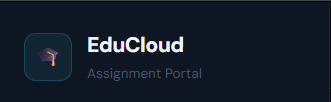
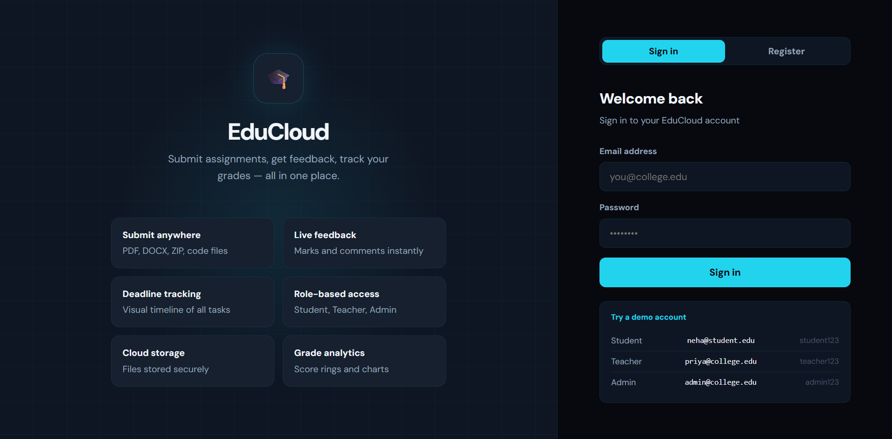
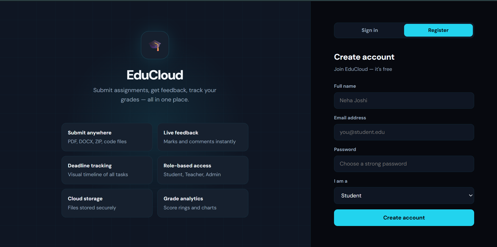
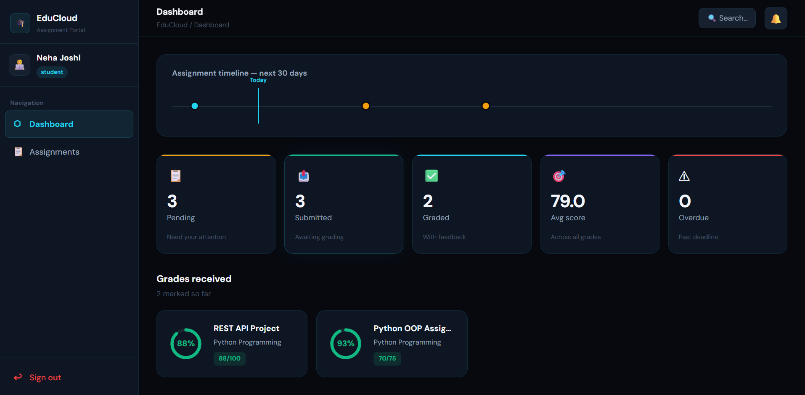
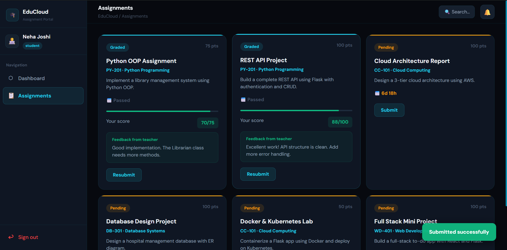
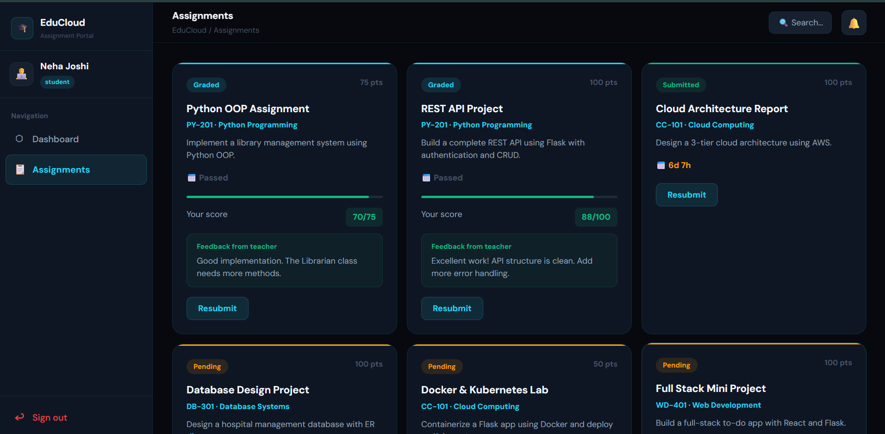
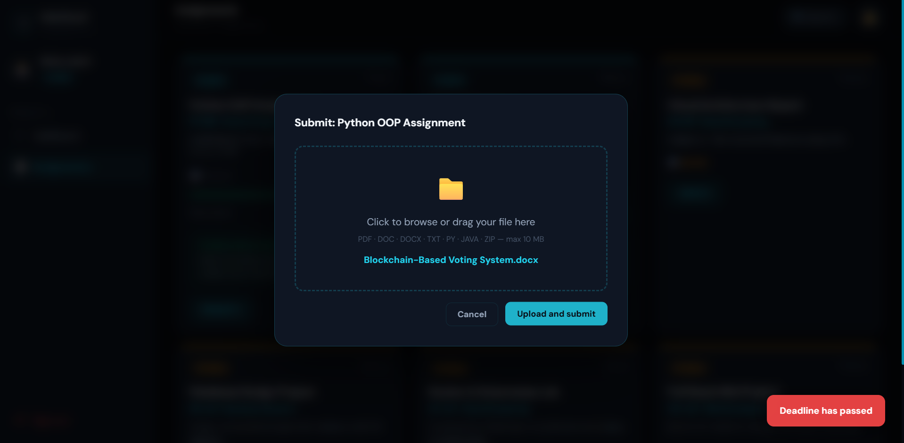

<div align="center">




**[🌐 Live Demo](https://cloud-assignment-portal.onrender.com)**
&nbsp;&nbsp;·&nbsp;&nbsp;
**[💻 Source Code](https://github.com/Neha-Joshi05/Cloud-Assignment-Submission-Feedback-Portal.git)**

</div>

---

## 📸 Screenshots

<div align="center">

### Login Page — Role-Based Access


<br/>

### Login Page — Role-Based Access


<br/>

### Student Dashboard — Assignment Timeline + Score Rings


<br/>

### Submissions View — Grade All Students


<br/>

### Assignments Page — Submit & Track


<br/>

### File Upload Modal — Drag & Drop


<br/>


</div>

---

## 🎯 Objective

Build a complete cloud-based assignment management system
demonstrating core cloud computing concepts — multi-tenant
role-based access control, REST APIs, cloud file storage,
cloud database design, session authentication, and real-time
analytics — deployed live on a cloud platform.

---

## ☁️ Cloud Computing Concepts Demonstrated

| Cloud Concept | How It's Implemented |
|---|---|
| **SaaS Model** | Web-based portal — no installation needed |
| **Multi-Tenancy** | One system serves students, teachers, admins |
| **RBAC** | Role-Based Access Control at every route |
| **Cloud Database** | SQLite locally → PostgreSQL in production |
| **Cloud Storage** | File uploads simulating AWS S3 / Supabase |
| **REST APIs** | `/api/stats`, `/api/notifications/read` endpoints |
| **Session Auth** | Server-side session management |
| **Cloud Deployment** | Live on Render (PaaS platform) |
| **Scalability** | Stateless Flask app — horizontally scalable |
| **Auto-seeding** | Database seeds on first deploy automatically |

---

## 👥 User Roles

| Role | Access | Demo Login |
|---|---|---|
| 👨‍🎓 **Student** | View assignments, submit files, see grades and feedback | neha@student.edu / student123 |
| 👩‍🏫 **Teacher** | Create assignments, view submissions, grade students | priya@college.edu / teacher123 |
| ⚙️ **Admin** | View all users, courses, assignments, system stats | admin@college.edu / admin123 |

---

## ✨ Features

### Student Features
| Feature | Description |
|---|---|
| 📅 **Assignment Timeline** | Visual horizontal timeline — all assignments plotted by deadline |
| ⭕ **Score Rings** | SVG circular arcs showing grade percentage for each assignment |
| 📤 **File Submission** | Drag and drop upload — PDF, DOCX, ZIP, PY, JAVA |
| 💬 **Feedback View** | Teacher comments shown directly on assignment card |
| 📊 **Grade Tracking** | Average score, pending, submitted, graded counts |
| 🔔 **Notifications** | Bell with unread count — grade alerts, new assignments |
| 🔄 **Resubmission** | Resubmit allowed assignments before deadline |

### Teacher Features
| Feature | Description |
|---|---|
| ➕ **Create Assignments** | Title, description, deadline, max marks, course |
| 👁️ **View Submissions** | All student files with download links |
| ✏️ **Grade + Feedback** | Enter marks and written feedback per student |
| 📈 **Analytics Charts** | Submissions over time (bar chart), grade distribution (doughnut) |
| ⚠️ **Missing Tracker** | See which students have not submitted |
| 📥 **Bulk Overview** | Progress bars showing graded/total per assignment |

### Admin Features
| Feature | Description |
|---|---|
| 👥 **User Management** | View all students, teachers, admins |
| 📊 **System Stats** | Total users, courses, assignments, submissions |
| 🏫 **Course Overview** | All courses and their teachers |

---

## 🏗️ Architecture

```
┌─────────────────────────────────────────────────────────┐
│                   CLOUD DEPLOYMENT (Render)             │
│                                                         │
│  ┌─────────────┐    ┌────────────────────────────────┐  │
│  │  Web Client │───▶│     Flask Application          │  │
│  │  (Browser)  │    │   (Python WSGI Server)         │  │
│  └─────────────┘    └────────────┬───────────────────┘  │
│                                  │                       │
│               ┌──────────────────┼──────────────┐        │
│               ▼                  ▼              ▼        │
│        ┌─────────────┐  ┌──────────────┐  ┌──────────┐  │
│        │  SQLite DB  │  │ File Storage │  │  REST API│  │
│        │ (→PostgreSQL│  │ (→AWS S3 in  │  │Endpoints │  │
│        │  in prod)   │  │  production) │  │          │  │
│        └─────────────┘  └──────────────┘  └──────────┘  │
└─────────────────────────────────────────────────────────┘
```

---

## 🔄 Application Flow

```
User visits portal
      ↓
Login with role (Student / Teacher / Admin)
      ↓
Session created → Role-based dashboard loaded
      ↓
┌─────────────────────────────────┐
│ STUDENT                         │
│ → View timeline + assignments   │
│ → Upload file (cloud storage)   │
│ → Get notification on grading   │
│ → View score ring + feedback    │
└─────────────────────────────────┘
┌─────────────────────────────────┐
│ TEACHER                         │
│ → Create assignment             │
│ → Students get notifications    │
│ → View all submissions          │
│ → Enter marks + feedback        │
│ → Students notified of grade    │
└─────────────────────────────────┘
```

---

## 🛠️ Tech Stack

| Layer | Technology |
|---|---|
| Backend | Python 3, Flask 3.0 |
| Database | SQLite (local) → PostgreSQL (production) |
| File Storage | Local uploads folder → AWS S3 (production) |
| Frontend | HTML5, CSS3, Vanilla JavaScript |
| Charts | Chart.js (bar + doughnut) |
| Fonts | DM Sans (Google Fonts) |
| Auth | Session-based with SHA-256 password hashing |
| Deployment | Render (PaaS) |
| Version Control | Git + GitHub |

---

## 📁 Folder Structure

```
Cloud-Assignment-Submission-Feedback-Portal/
│
├── dashboard/
│   ├── app.py                  ← Flask app — all routes and logic
│   └── templates/
│       └── index.html          ← Full premium UI (single template)
│
├── uploads/                    ← Cloud file storage (auto-created)
├── portal.db                   ← SQLite cloud database (auto-created)
│
├── screenshots/                ← Proof of work screenshots
│   ├── 01_login.png
│   ├── 02_student_dashboard.png
│   ├── 03_timeline.png
│   ├── 04_assignments.png
│   ├── 05_upload.png
│   ├── 06_teacher_dashboard.png
│   ├── 07_submissions.png
│   ├── 08_grade.png
│   ├── 09_admin.png
│   └── 10_github.png
│
├── requirements.txt            ← Python dependencies
├── Procfile                    ← Render deployment config
├── .gitignore
└── README.md
```

---

## 🚀 How to Run Locally

```bash
# Clone the repo
git clone https://github.com/Neha-Joshi05/Cloud-Assignment-Submission-Feedback-Portal.git
cd Cloud-Assignment-Submission-Feedback-Portal

# Install dependencies
pip install -r requirements.txt

# Run the app
python dashboard/app.py

# Open in browser
http://localhost:5000
```

The database and demo data are created **automatically** on first run.

---

## 🔌 REST API Endpoints

| Method | Endpoint | Description | Access |
|---|---|---|---|
| GET | `/` | Redirect to login or dashboard | Public |
| GET/POST | `/login` | Login with email + password | Public |
| POST | `/register` | Create new account | Public |
| GET | `/logout` | Clear session | Auth |
| GET | `/dashboard` | Role-based dashboard | Auth |
| GET | `/assignments` | List assignments | Auth |
| POST | `/assignments/create` | Create new assignment | Teacher |
| POST | `/submit/<id>` | Upload file submission | Student |
| GET | `/submissions/<id>` | View all submissions | Teacher |
| POST | `/grade/<id>` | Enter marks + feedback | Teacher |
| GET | `/download/<path>` | Download submitted file | Auth |
| POST | `/api/notifications/read` | Mark notifications read | Auth |
| GET | `/api/stats` | Analytics data (JSON) | Auth |

---

## 🗄️ Database Schema

```sql
users        → user_id, name, email, password, role, avatar
courses      → course_id, course_name, course_code, teacher_id
enrollments  → enrollment_id, course_id, student_id
assignments  → assignment_id, course_id, title, description,
               deadline, max_marks, allow_resubmit, created_by
submissions  → submission_id, assignment_id, student_id,
               file_name, storage_path, file_size_kb,
               submitted_at, status, marks, feedback, graded_at
notifications→ notif_id, user_id, message, is_read
```

---

## 🔮 Future Improvements

- JWT token-based authentication
- PostgreSQL with connection pooling
- AWS S3 for file storage
- Redis for session caching
- Email notifications (SMTP)
- Assignment plagiarism detection
- Video submission support
- Mobile app (React Native)
- Real-time updates (WebSockets)
- AI-powered feedback suggestions
- Docker + Kubernetes deployment
- CI/CD pipeline with GitHub Actions

---

## 👤 Author

**Neha Joshi**
- GitHub: [@Neha-Joshi05](https://github.com/Neha-Joshi05/Cloud-Assignment-Submission-Feedback-Portal.git) | LinkedIn : (https://www.linkedin.com/in/neha-joshi-0851a2322?utm_source=share_via&utm_content=profile&utm_medium=member_android)
- 